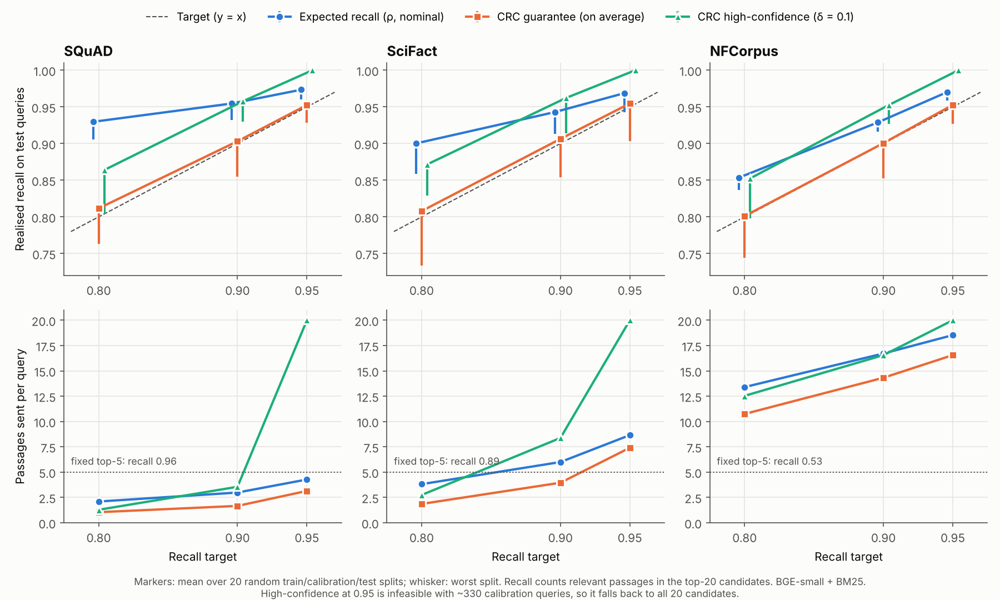
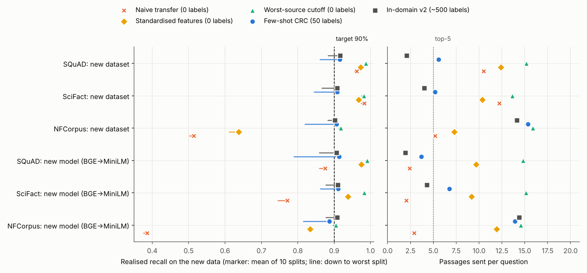

# Calibre

**Calibrated hybrid retrieval that knows how much context is enough.**

Calibre is a drop-in layer between hybrid search (BM25 + dense) and the LLM in a RAG pipeline or agent. Instead of always sending a fixed top-k, it:

1. **Fuses** BM25 and dense scores with a tuned fixed blend (matched or beat RRF on most pilot datasets).
2. **Calibrates** each passage into a probability of relevance *(v1)*.
3. **Cuts off** the list adaptively, sending 1 passage for an easy question and 8 for a hard one.
4. **Guarantees** a recall target on that cutoff *(v2)*, even after a dataset or model change *(v3)*.
5. **Flags** when nothing retrieved is relevant, so an agent can retry, widen or abstain *(v1, v4)*.

## Versions

Each version adds one capability, ships on its own, and supports one claim.

| Version | Level | Adds | Status |
|---|---|---|---|
| v0 | `baseline` | Tuned fixed blend, raw-score cutoff, top-k fallback | **Implemented** |
| v1 | `calibrated` | P(relevant) per passage, probability cutoff, `nothing_relevant` flag | **Implemented** |
| v2 | `guaranteed` | Recall guarantee on the cutoff (expected recall / conformal risk control) | **Implemented** |
| v3 | `portable` | Calibration and guarantees after a dataset / embedding-model change | **Implemented** (research core) |
| v4 | agentic | Search tool for agents (smolagents / MCP) | Planned |

Each version has a folder in [`experiments/`](experiments/) with its hypothesis, plan and results.

## Demo

[`demo/`](demo/) is a chat-style demo on real test questions (Wikipedia, science papers, nutrition research). Each reply shows the answer, how much context Calibre sent compared with a fixed top-5, and the passages it used. Switches set the recall target and what Calibre was calibrated on (this dataset, other datasets only, or other datasets plus 50 labels).

Open `demo/index.html` in a browser to run it locally. It's a static site, so it deploys on Vercel with the root directory set to `demo` (see [`demo/README.md`](demo/README.md)).

## Quickstart

### 1. Install (Windows PowerShell)

```powershell
cd C:\Users\v5run\github\Calibre
python -m venv .venv
.\.venv\Scripts\Activate.ps1
pip install -e ".[dev]"
```

If PowerShell blocks the activate script, run `Set-ExecutionPolicy -Scope CurrentUser RemoteSigned` once, then activate again. On macOS/Linux, activate with `source .venv/bin/activate`.

### 2. Run the tests

```powershell
pytest
```

### 3. Try the demo

```powershell
python examples/try_calibre.py
```

It blends a small set of fake BM25 and dense results, then shows that a score cutoff (τ = 0.7) sends only the clearly relevant passage, while a fixed top-5 sends everything:

```
Fused ranking: [('doc1', 0.96), ('doc4', 0.68), ('doc7', 0.29), ('doc9', 0.21), ('doc2', 0.0)]
Top-5 sends:   ['doc1', 'doc4', 'doc7', 'doc9', 'doc2']
Cutoff sends:  ['doc1'] (1 passage)
```

### 4. Use it in code

```python
from calibre_rag import Calibre, Hit
from calibre_rag.cutoff import ScoreThreshold

bm25  = [Hit("doc1", 12.3), Hit("doc7", 9.1), Hit("doc4", 3.2)]
dense = [Hit("doc4", 0.82), Hit("doc1", 0.79), Hit("doc9", 0.55)]

cal = Calibre(alpha=0.6, cutoff=ScoreThreshold(tau=0.7))
res = cal.retrieve(bm25, dense)
res.doc_ids, res.cutoff_k
```

With real search results, convert your BM25 and vector-store results into `Hit(doc_id, score)` lists and pass them to `retrieve()`.

### 5. Tune on labelled queries

```python
from calibre_rag.fusion import tune_alpha, convex_combination
from calibre_rag.cutoff import fit_score_threshold

alpha, curve = tune_alpha(train_runs, train_qrels)            # runs: qid -> (bm25_hits, dense_hits)
fused = {q: convex_combination(*train_runs[q], alpha=alpha) for q in train_runs}
policy, report = fit_score_threshold(fused, train_qrels, match_topk=5)   # fewest passages at top-5 recall
```

### 6. Calibrate and guarantee recall (v1, v2)

```python
from calibre_rag import Calibre
from calibre_rag.calibrate import Calibrator
from calibre_rag.cutoff import fit_recall_guarantee

cal = Calibrator(alpha=alpha).fit(train_runs, train_qrels)                 # v1: P(relevant) per passage
policy = fit_recall_guarantee(cal.predict_runs(calib_runs), calib_qrels,   # v2: on queries the
                              target=0.9)                                  # calibrator never saw

calibre = Calibre(level="guaranteed", calibrator=cal, cutoff=policy)
res = calibre.retrieve(bm25, dense)
res.doc_ids, res.expected_relevant, res.nothing_relevant
```

`fit_recall_guarantee` promises **E[recall] ≥ target** on new queries from the same distribution as the calibration queries. Pass `delta=0.1` for the stricter version (recall ≥ target with 90% confidence), which sends more passages. Run `python examples/try_guarantee.py` for a self-contained example.

### 7. Move to a new dataset or embedding model (v3)

```python
from calibre_rag.shift import PortableCalibrator, fit_worst_source_guarantee

pc = PortableCalibrator(alpha=alpha).fit({"scifact": (train_a, qrels), "nfcorpus": (train_b, qrels)})

# No labels on the new data: worst-source cutoff, fitted on held-out source queries
cands = {}
for name, runs in {"scifact": calib_a, "nfcorpus": calib_b}.items():
    pc.use(name); cands[name] = pc.predict_runs(runs)
policy = fit_worst_source_guarantee(cands, qrels, target=0.9)
pc.adapt(new_unlabelled_runs)          # standardise features on the new collection, no labels

# Once ~50 questions on the new data are labelled: recalibrate and refit the guarantee on them
pc.recalibrate(few_runs, few_qrels)
policy = fit_recall_guarantee(pc.predict_runs(few_runs), few_qrels, target=0.9)

calibre = Calibre(level="portable", calibrator=pc, cutoff=policy)
```

## Layout

```
calibre_rag/
  core.py        # Calibre entry point (versions = levels)
  types.py       # Hit, ScoredHit, Result
  fusion/        # v0: normalisation, convex combination, RRF, alpha tuning
  cutoff/        # v0: top-k, score threshold; v1: probability threshold; v2: expected recall, recall guarantee (CRC)
  calibrate/     # v1: features, logistic / isotonic calibrator, Platt recalibration, ECE
  shift/         # v3: PortableCalibrator, weighted / worst-source guarantees
  adapters/      # LangChain, LlamaIndex, Weaviate, Qdrant, smolagents/MCP (planned)
  eval/          # nDCG@k, recall@k, selection recall
examples/
  try_calibre.py # quick v0 demo
  try_guarantee.py # v1 + v2 on synthetic data
demo/            # chat-style web demo (static site)
docs/figures/     # pilot figures used in this README
experiments/
  v0_baseline/  v1_calibrated/  v2_guaranteed/  v3_portable/  v4_agentic/
tests/
```

The import name is `calibre_rag` (distribution `calibre-rag`) to avoid clashing with the `calibre` e-book application's Python modules.

## Preliminary results (pilot study)

Before building this repo, a small pilot tested the core idea on five public retrieval datasets. These results are **preliminary**: they come from pilot code outside this repo and will be reproduced at scale by the experiments in [`experiments/`](experiments/).

**Setup:** BM25 + a small embedding model (MiniLM-L6 or BGE-small), datasets SciFact, NFCorpus, NPL, SQuAD (paragraphs) and CISI, each up to ~15k passages. Queries were split 50/50 into train and test, 10 random splits. No LLM was run; answer coverage on SQuAD was checked by string matching.

### Passages sent at the same recall as a fixed top-5

The cutoff threshold was tuned on training queries to match top-5's recall, then measured on held-out test queries (BGE-small; negative = fewer passages):

| Dataset | Raw-score cutoff (v0) | Calibrated cutoff (v1) |
|---|---|---|
| SciFact | −28% | −34% |
| NFCorpus | −20% | −21% |
| SQuAD | −27% | −36% |
| CISI | +3% | −11% |
| NPL | **+15%** | **+34%** |


- On SciFact, NFCorpus and SQuAD, a cutoff sent 20–40% fewer passages than top-5 at equal recall. On SQuAD, the calibrated cutoff needed ~32% fewer tokens to keep the answer in the context.
- **Most of the saving comes from the cutoff itself** (v0); calibration (v1) added 5–15 more points on SciFact and SQuAD.
- **Dynamic cutoffs were worse on NPL**, where each query has many relevant documents, so a top-k fallback is needed. CISI results are noisy (76 queries).

<details>
<summary>Full passages-vs-recall curves for every method</summary>


</details>

### Recall guarantee (v2)

Run in this repo ([`experiments/v2_guaranteed/`](experiments/v2_guaranteed/)): calibrator trained on 40% of queries, cutoff fitted on 30%, measured on the other 30%, over 20 random splits (BGE-small + BM25).



- **The guarantee holds:** mean realised recall was 0.80–0.81, 0.90–0.91 and 0.95–0.96 for targets of 80%, 90% and 95% on SQuAD, SciFact and NFCorpus.
- **It sends fewer passages where top-5 is wasteful:** 95% recall with 3.1 passages on SQuAD (top-5: 0.96 with 5), and 91% with 4.0 on SciFact (top-5: 0.89 with 5).
- **It sends more where top-5 misses:** on NFCorpus top-5 finds about half the relevant passages; 90% recall takes ~14.
- The guarantee is on average over calibration draws; individual splits landed up to 0.07 under. The `delta` option fixes that at the cost of more passages.

### After a dataset or model change (v3)

Run in this repo ([`experiments/v3_portable/`](experiments/v3_portable/)): calibrate on other collections, deploy on a new one (or on a new embedding model, BGE → MiniLM), 90% recall target, 10 splits.



- **Naive transfer is unpredictable:** a "90%" cutoff realised 39%–98% recall, under-delivering badly on NFCorpus.
- **With no labels, only the worst-source cutoff met the target in all six shifts** (0.905–0.991), at ~14–16 passages per question. Safe, but costly.
- **50 labelled questions restore it at near in-domain cost:** few-shot CRC averaged 0.89–0.92 recall in every shift, with 1.0–2.7× the passages of a cutoff fitted on ~500 in-domain labels. Single runs vary more (worst split 0.79–0.86).

### Other findings

- **Fusion:** a tuned fixed blend (v0's default) beat RRF on SciFact, NFCorpus and SQuAD (up to +0.04 nDCG@10 on SQuAD) and was within ±0.015 on NPL and CISI.
- **Calibration** (v1): ECE ≈ 0.04 on held-out queries from the same dataset in the pilot (0.005–0.014 with the repo's calibrator and larger splits), vs ≈ 0.23 for raw fused scores, at ~0.13 ms per query.
- **Guarantees across datasets** (v3, pilot): a 90% recall guarantee held in-domain but landed anywhere from 38% to 100% on a dataset the calibrator hadn't seen. The repo's v3 experiment above reproduces this and measures the fixes.
- **Not tested yet:** stronger embedders, SPLADE, rerankers, larger corpora, and real LLM answers.

## Development

- Python ≥ 3.10; runtime dependency is NumPy only (the v1 calibrator is plain NumPy).
- Experiment artifacts (`data/`, `cache/`, `runs/`, `*.pkl`) are git-ignored and regenerated by scripts.
- Tag each version on release (`v0.1`, `v1.0`, …).
