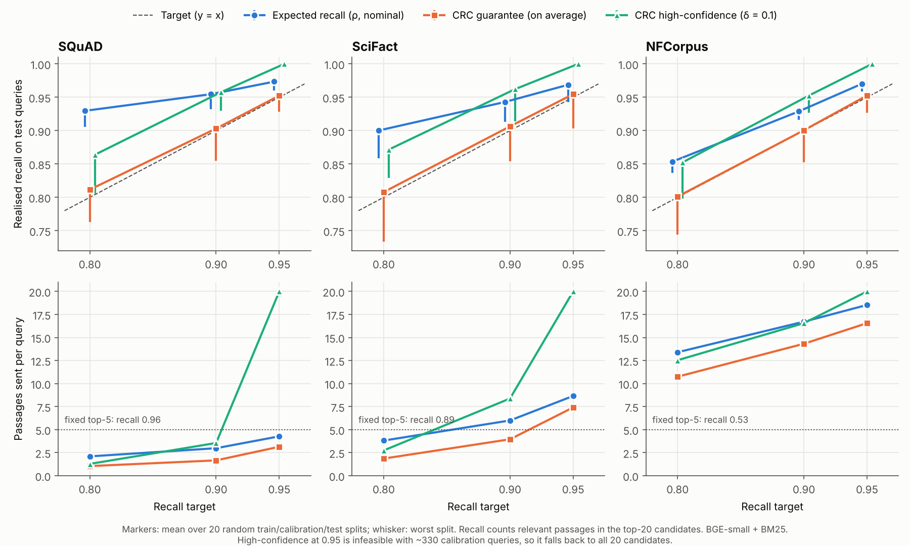

# v2: Guaranteed

**Hypothesis.** Expected-recall and conformal cutoffs on calibrated probabilities hold their recall target in-domain, and send fewer passages than a fixed top-k at the same recall.

**Method** (`calibre_rag/cutoff/policies.py`, `calibre_rag/cutoff/guarantee.py`)

- **`ExpectedRecall(rho)`** keeps the smallest k with Σ p[:k] ≥ ρ · Σ p[:20]. It trusts the probabilities, so its target is nominal, not guaranteed.
- **`fit_recall_guarantee(target)`** uses conformal risk control (Angelopoulos et al., 2022). On n held-out calibration queries, with loss = 1 − recall, it picks the most aggressive threshold t satisfying

  (n / (n+1)) · mean loss(t) + 1 / (n+1) ≤ 1 − target.

  If the calibration and new queries come from the same distribution, then **E[recall] ≥ target**.
- **`fit_recall_guarantee(target, delta=0.1)`** is a high-confidence variant using a Hoeffding bound (Learn-then-Test). Recall ≥ target holds with probability ≥ 1 − δ over the calibration draw, at the cost of sending more passages.

The guarantee has these limits:
- Recall is over relevant passages among the top-20 candidates.
- It is averaged over queries that have one or more relevant candidates.
- It does not hold after a dataset or model change without recalibrating (v3).

**Protocol.** [`validate_pilot.py`](validate_pilot.py) runs on the pilot caches (BM25 + BGE-small top-100 lists) and repeats over 20 random splits:
- 40% of queries train the calibrator;
- 30% fit the cutoff;
- 30% are the test set.

[`plot_results.py`](plot_results.py) draws the chart. Raw numbers are in [`results.json`](results.json).

**Results.** Each cell shows realised recall / passages sent, averaged over 20 splits.

| Dataset | Fixed top-5 | Guarantee 80% | Guarantee 90% | Guarantee 95% | High-conf 90% (δ=0.1) |
|---|---|---|---|---|---|
| SQuAD | 0.963 / 5.0 | 0.812 / 1.0 | 0.903 / 1.7 | 0.952 / **3.1** | 0.958 / 3.6 |
| SciFact | 0.892 / 5.0 | 0.808 / 1.9 | 0.906 / **4.0** | 0.955 / 7.4 | 0.962 / 8.4 |
| NFCorpus | 0.525 / 5.0 | 0.801 / 10.8 | 0.901 / 14.3 | 0.953 / 16.6 | 0.953 / 16.6 |

- **The guarantee holds.** Mean realised recall is at or just above every target on all three datasets: 0.801–0.812 for 80%, 0.901–0.906 for 90%, and 0.952–0.955 for 95%.
- **Fewer passages at top-5's recall:**
  - On SQuAD, 0.95 recall costs 3.1 passages vs 5 (−37%).
  - On SciFact, 0.91 recall costs 4.0 passages vs 5 (−21%).
- **NFCorpus shows the other side.** Top-5 finds only about half the relevant passages, so a recall guarantee *spends* more (11–17 passages). The cutoff adapts in both directions; it doesn't only shrink.
- **"On average" vs "high-confidence":**
  - The average guarantee met its target on 50–70% of individual splits, which is expected for a promise about the mean. The worst split fell 0.02–0.07 under.
  - The δ = 0.1 version met its target on 95–100% of splits but sends more.
  - At 95% it is infeasible with ~330–550 calibration queries and falls back to all 20 candidates.
- **The nominal `ExpectedRecall` overshoots** (for example, 0.93 at a 0.8 target on SQuAD), so it sends extra passages. CRC spends exactly what the target needs.

**Still to do:**
- 100+ splits;
- the comparison with conformal context filtering on raw dense scores (Chakraborty et al., 2025);
- placing calibration before or after a cross-encoder reranker;
- answer-level checks with an LLM.
