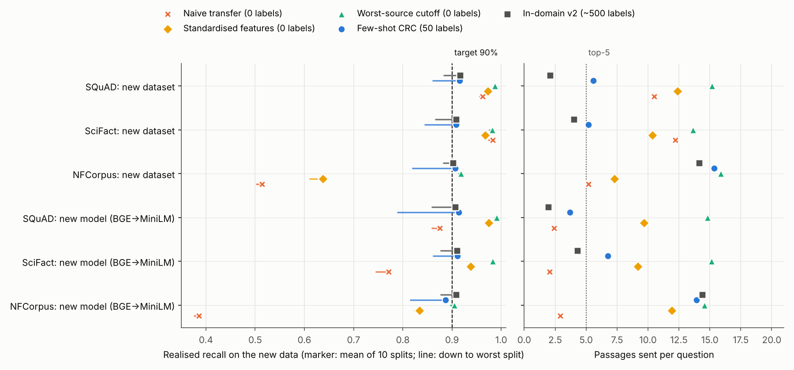

# v3: Portable

**Question.** v2's guarantee assumes new questions look like the calibration questions. Does it survive a new dataset or a new embedding model, and how many labels does it take to restore it?

**Methods** (`calibre_rag/shift/`)

| Method | Labels from the new data | What it does |
|---|---|---|
| Naive transfer | 0 | v1 + v2 fitted on other collections, used as-is |
| Standardised features (`PortableCalibrator`) | 0 | Trained on several collections, each feature standardised within its own collection; `.adapt(unlabelled_runs)` re-standardises on the new one |
| Weighted CRC (`fit_weighted_recall_guarantee`) | 0 | Reweights source calibration questions by how much they look like the new questions (domain classifier odds) |
| Worst-source cutoff (`fit_worst_source_guarantee`) | 0 | The threshold that meets the target on every source collection separately |
| Few-shot Platt + ExpectedRecall | k | Re-fits Platt on k labelled questions, then cuts at ρ of the expected relevant passages |
| Few-shot CRC | k | Fits the v2 guarantee directly on k labelled questions from the new data, so its guarantee holds by construction |
| In-domain v2 (reference) | ~500 | v1 + v2 fitted on the new data itself |

**Protocol.** [`run_shift.py`](run_shift.py), on the pilot caches. Target recall 0.9, 10 random splits of the new data into an unlabelled pool (few-shot labels are drawn from it) and a test half.
- **Dataset shift:** calibrate on four BGE collections (out of SQuAD, SciFact, NFCorpus, NPL, CISI), deploy on the fifth. Only SQuAD, SciFact and NFCorpus are evaluated as targets; NPL and CISI are too small.
- **Model shift:** calibrate on all five BGE collections, deploy on the MiniLM version of one collection.

**Results.** Realised recall / passages per question at a 0.9 target, mean of 10 splits (raw numbers in [`results.json`](results.json)):

| Shift | Naive | Standardised | Worst-source | Few-shot CRC (50) | In-domain (~500) | Top-5 |
|---|---|---|---|---|---|---|
| New dataset: SQuAD | 0.96 / 10.5 | 0.97 / 12.4 | 0.99 / 15.2 | 0.92 / 5.6 | 0.92 / 2.1 | 0.96 / 5 |
| New dataset: SciFact | 0.98 / 12.2 | 0.97 / 10.4 | 0.98 / 13.6 | 0.91 / 5.2 | 0.91 / 4.0 | 0.90 / 5 |
| New dataset: NFCorpus | **0.51** / 5.2 | **0.64** / 7.3 | 0.92 / 15.9 | 0.91 / 15.4 | 0.90 / 14.1 | 0.53 / 5 |
| New model: SQuAD | 0.88 / 2.4 | 0.97 / 9.7 | 0.99 / 14.8 | 0.91 / 3.7 | 0.91 / 2.0 | 0.96 / 5 |
| New model: SciFact | **0.77** / 2.0 | 0.94 / 9.2 | 0.98 / 15.2 | 0.91 / 6.8 | 0.91 / 4.3 | 0.90 / 5 |
| New model: NFCorpus | **0.39** / 2.9 | 0.83 / 11.9 | 0.91 / 14.6 | 0.89 / 13.9 | 0.91 / 14.4 | 0.53 / 5 |

- **Naive transfer is unpredictable.** A "90%" cutoff realised anywhere from 39% to 98% recall. It over-spends on easy collections, which is wasteful, and under-delivers badly on NFCorpus, which is dangerous.
- **With no labels, only the worst-source cutoff met the target everywhere** (0.905–0.991). The price is ~14–16 passages per question on every collection: safe, but no cheaper than a big fixed top-k.
- **Standardising features within each collection helps but doesn't fix it.** It lifts the worst cases (NFCorpus with a new model: 0.39 → 0.83; SciFact with a new model: 0.77 → 0.94) but still misses on NFCorpus.
- **Weighted CRC lands in between** (0.81–0.97) and also misses on NFCorpus. Its covariate-shift assumption doesn't hold well across retrieval collections.
- **50 labels restore the guarantee at close to in-domain cost.** Few-shot CRC averaged 0.887–0.915 recall in all six shifts, sending 1.0–2.7× the passages of the in-domain cutoff (which needs ~500 labels).
  - Single runs vary more, because the guarantee is computed from only 50 questions: the worst split fell to 0.79–0.86.
  - Few-shot Platt + ExpectedRecall is steadier (0.93–0.99), but sends more passages.
- **10 labels are not enough for CRC at 90%.** The finite-sample penalty (1/(k+1) ≈ 0.09) leaves almost no room, so it often falls back to all 20 passages.

**Verdict on the proposal's v3 claim** ("guarantee within ±0.05 of target after a switch with 0–25 labels"):

| Labels | Result |
|---|---|
| 0 | Not met cheaply. Only worst-source is reliable, and it is conservative. |
| 25 | On average, mean recall was within 0.05 of the target in every shift, but variance across splits is high. |
| 50 | Met on average in all six shifts, at near in-domain cost. |

The practical recipe is **worst-source with no labels, then switch to few-shot CRC once ~50 questions are labelled**.

**Still to do:**
- LLM-judged labels as cheap few-shot labels, with prediction-powered inference;
- label-free collection features beyond standardisation;
- more source collections (full BEIR);
- a high-confidence (δ) version of few-shot CRC.
